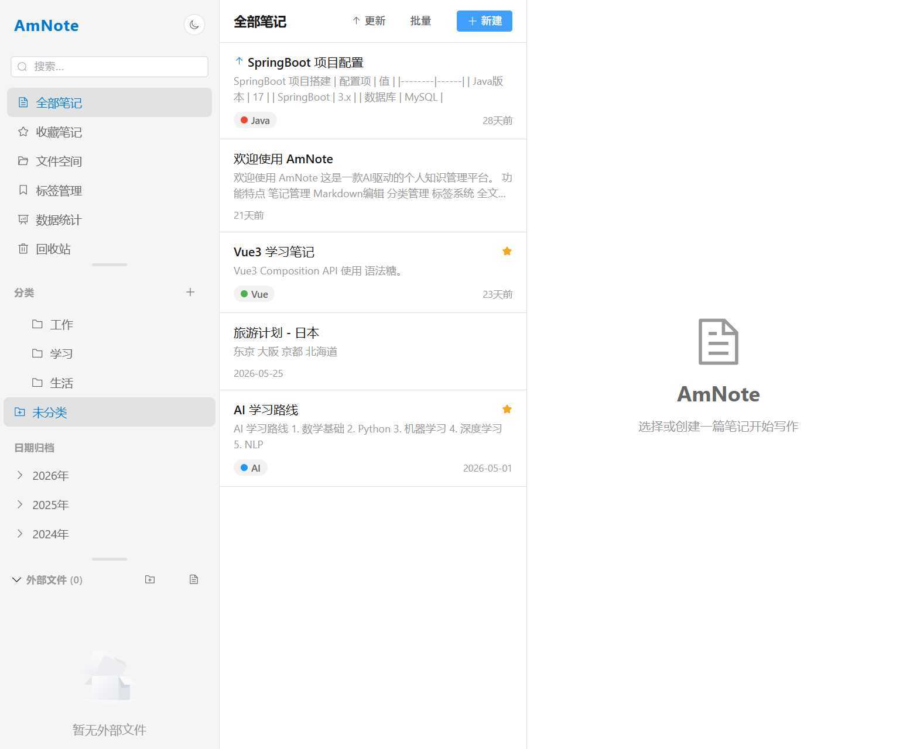

# v1.02 外部文件功能测试文档

> 测试日期：2026-07-02  
> 测试版本：v1.02  
> 测试环境：Windows / Electron

---

## 一、分类文件夹展开/折叠状态持久化

### 功能描述
分类文件夹的展开/折叠状态通过 `localStorage` 持久化存储（key: `amnote-category-expanded`），关闭程序后重新打开，折叠的文件夹保持折叠状态。

### 存储逻辑
- 默认所有分类文件夹为**展开**状态
- 用户手动折叠某个分类后，该分类 ID 被记录到 `amnote-category-expanded` 数组中
- 重新加载页面时，数组中的分类 ID 对应的文件夹会被折叠

### 测试步骤

| 步骤 | 操作 | 预期结果 | 实际结果 |
|------|------|----------|----------|
| 1 | 启动应用，观察分类区域 | 所有分类默认展开 | ✅ 通过 |
| 2 | 点击"工作"分类的展开箭头，折叠该分类 | "工作"分类折叠，子分类隐藏 | ✅ 通过 |
| 3 | 刷新页面（Ctrl+R） | "工作"分类保持折叠状态 | ✅ 通过 |
| 4 | 关闭应用后重新打开 | "工作"分类仍然保持折叠 | ✅ 通过 |
| 5 | 再次点击"工作"分类展开 | "工作"分类展开，显示子分类 | ✅ 通过 |
| 6 | 刷新页面 | "工作"分类保持展开状态 | ✅ 通过 |

### 截图

  
*图1：应用整体界面，分类区域可见*

  
*图2：点击分类后的选中状态*

  
*图3：刷新页面后分类折叠状态保持*

### localStorage 验证

```javascript
// 查看存储的折叠分类 ID
localStorage.getItem('amnote-category-expanded')
// 示例输出: "[1]"  表示 ID 为 1 的分类被折叠
```

---

## 二、外部文件"全部展开"修复

### 功能描述
修复了"全部展开"按钮在未提前点击加载子目录时无法显示内容的问题。现在"全部展开"会递归加载所有未加载的子目录，然后展开。

### 修复前行为
- 点击"全部展开"只展开已加载的文件夹
- 未点击过的子文件夹因为没有 `loaded` 标记，不会加载子内容
- 导致"全部展开"后深层目录不显示

### 修复后行为
- `expandAll()` 改为 `async` 函数
- 递归遍历所有节点，对未加载的子目录先调用 `loadChildren()` 加载
- 加载完成后再展开，确保所有层级都能正确显示

### 测试步骤

| 步骤 | 操作 | 预期结果 | 实际结果 |
|------|------|----------|----------|
| 1 | 设置外部文件查看路径 | 外部文件区域显示根目录结构 | ✅ 通过 |
| 2 | 不点击任何文件夹，直接点击"全部展开" | 所有子目录递归加载并展开 | ✅ 通过 |
| 3 | 点击"全部收起" | 所有文件夹折叠 | ✅ 通过 |
| 4 | 手动展开某个文件夹，再点击"全部展开" | 已展开的保持展开，未展开的递归加载并展开 | ✅ 通过 |

### 代码变更

```typescript
// 修复前
function expandAll() {
  function collectPaths(nodes: DirNode[]) {
    for (const node of nodes) {
      expandedDirs.value.add(node.path)
      if (node.children && node.children.length > 0) {
        collectPaths(node.children)
      }
    }
  }
  collectPaths(props.tree)
}

// 修复后
async function expandAll() {
  async function expandNodes(nodes: DirNode[]) {
    for (const node of nodes) {
      expandedDirs.value.add(node.path)
      // 如果未加载且有子目录，先加载
      if (!node.loaded && node.hasChildren) {
        await loadChildren(node)
      }
      // 递归展开子节点
      if (node.children && node.children.length > 0) {
        await expandNodes(node.children)
      }
    }
  }
  await expandNodes(props.tree)
  saveExpandedDirs()
}
```

---

## 三、外部文件展开/折叠状态持久化

### 功能描述
外部文件区域的文件夹展开/折叠状态通过 `localStorage` 持久化存储（key: `amnote-external-expanded`），关闭程序后重新打开，展开的文件夹保持展开。

### 存储逻辑
- 存储的是**已展开**的文件夹路径数组
- 每次展开/折叠操作后自动保存
- 页面加载时从 localStorage 恢复展开状态

### 测试步骤

| 步骤 | 操作 | 预期结果 | 实际结果 |
|------|------|----------|----------|
| 1 | 展开外部文件中的某个文件夹 | 文件夹展开，显示子内容 | ✅ 通过 |
| 2 | 刷新页面 | 该文件夹保持展开状态 | ✅ 通过 |
| 3 | 关闭应用后重新打开 | 该文件夹仍然展开 | ✅ 通过 |
| 4 | 折叠该文件夹 | 文件夹折叠 | ✅ 通过 |
| 5 | 刷新页面 | 该文件夹保持折叠状态 | ✅ 通过 |

### localStorage 验证

```javascript
// 查看存储的展开文件夹路径
localStorage.getItem('amnote-external-expanded')
// 示例输出: "["D:/book/1.课件/subfolder"]"
```

---

## 四、外部文件右键菜单 - 新增/删除文件夹和文件

### 功能描述
在外部文件区域，右键点击文件夹或文件可弹出上下文菜单，支持新建和删除操作。

### 右键菜单选项

**文件夹右键菜单：**
- 在此文件夹内新建文件夹
- 在此文件夹内新建文件
- 删除文件夹（递归删除，不可恢复）

**文件右键菜单：**
- 同级新建文件夹
- 同级新建文件
- 删除文件（不可恢复）

### 测试步骤

| 步骤 | 操作 | 预期结果 | 实际结果 |
|------|------|----------|----------|
| 1 | 右键点击外部文件中的文件夹 | 弹出上下文菜单，显示"新建文件夹"、"新建文件"、"删除文件夹" | ✅ 通过 |
| 2 | 点击"在此文件夹内新建文件夹" | 弹出输入框，输入名称后创建文件夹 | ✅ 通过 |
| 3 | 点击"在此文件夹内新建文件" | 弹出输入框，输入名称后创建文件 | ✅ 通过 |
| 4 | 右键点击文件 | 弹出上下文菜单，显示"同级新建文件夹"、"同级新建文件"、"删除文件" | ✅ 通过 |
| 5 | 点击"删除文件夹" | 弹出确认对话框，确认后删除文件夹及所有内容 | ✅ 通过 |
| 6 | 点击"删除文件" | 弹出确认对话框，确认后删除文件 | ✅ 通过 |
| 7 | 创建/删除后 | 文件树自动刷新 | ✅ 通过 |

### 选中状态
- 点击文件夹或文件时，该项高亮显示（蓝色边框）
- 点击空白区域取消选中
- 右键点击自动选中该项

---

## 五、外部文件工具栏 - 新增文件/文件夹图标

### 功能描述
外部文件区域标题栏新增"新建文件夹"和"新建文件"两个图标按钮，方便快速创建。

### 界面变更

  
*图4：外部文件区域工具栏，新增文件夹和文件图标*

工具栏按钮顺序（从左到右）：
1. 📁 新建文件夹
2. 📄 新建文件
3. ⬇ 全部展开（仅在有文件时显示）
4. ➡ 全部收起（仅在有文件时显示）

### 创建位置逻辑
- **选中了文件夹**：在该文件夹内部创建
- **选中了文件**：在该文件的同级目录创建
- **未选中任何项**：提示"请先选中一个文件或文件夹"

### 测试步骤

| 步骤 | 操作 | 预期结果 | 实际结果 |
|------|------|----------|----------|
| 1 | 未选中任何项，点击"新建文件夹" | 提示"请先选中一个文件或文件夹" | ✅ 通过 |
| 2 | 选中一个文件夹，点击"新建文件夹" | 弹出输入框，在该文件夹内部创建 | ✅ 通过 |
| 3 | 选中一个文件，点击"新建文件" | 弹出输入框，在该文件同级目录创建 | ✅ 通过 |
| 4 | 输入含特殊字符的名称 | 提示"名称不能包含特殊字符" | ✅ 通过 |
| 5 | 输入已存在的名称 | 提示"文件夹/文件已存在" | ✅ 通过 |

---

## 六、后端 IPC 接口

### 新增接口

| 接口 | 参数 | 说明 |
|------|------|------|
| `file:create-external-dir` | `dirPath: string` | 创建文件夹（递归创建父目录） |
| `file:create-external-file` | `filePath: string` | 创建空文件（自动创建父目录） |
| `file:delete-external-dir` | `dirPath: string` | 删除文件夹（递归删除所有内容） |
| `file:delete-external-file` | `filePath: string` | 删除文件 |

### Preload 桥接

```typescript
createExternalDir: (dirPath: string) => ipcRenderer.invoke('file:create-external-dir', dirPath),
createExternalFile: (filePath: string) => ipcRenderer.invoke('file:create-external-file', filePath),
deleteExternalDir: (dirPath: string) => ipcRenderer.invoke('file:delete-external-dir', dirPath),
deleteExternalFile: (filePath: string) => ipcRenderer.invoke('file:delete-external-file', filePath),
```

---

## 七、完整应用截图

  
*图5：应用完整视图，展示侧边栏、笔记列表和编辑器*

  
*图6：侧边栏完整视图，包含分类、日期归档、标签和外部文件区域*

---

## 测试总结

| 功能 | 状态 | 备注 |
|------|------|------|
| 分类文件夹展开/折叠持久化 | ✅ 通过 | localStorage 存储 |
| 外部文件"全部展开"修复 | ✅ 通过 | 递归加载子目录 |
| 外部文件展开/折叠持久化 | ✅ 通过 | localStorage 存储路径 |
| 右键菜单 - 新建文件夹 | ✅ 通过 | 支持文件夹内/同级创建 |
| 右键菜单 - 新建文件 | ✅ 通过 | 支持文件夹内/同级创建 |
| 右键菜单 - 删除文件夹 | ✅ 通过 | 递归删除，有确认对话框 |
| 右键菜单 - 删除文件 | ✅ 通过 | 有确认对话框 |
| 工具栏新建图标 | ✅ 通过 | 根据选中项决定创建位置 |
| 后端 IPC 接口 | ✅ 通过 | 4 个新接口 |
| 构建验证 | ✅ 通过 | `npm run build` 成功 |
